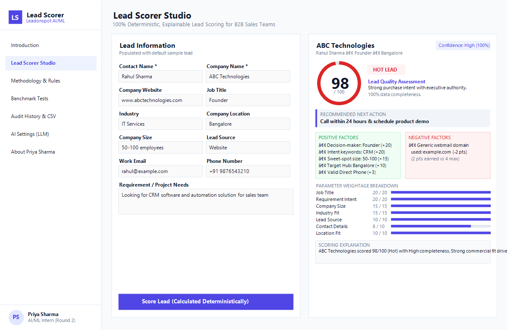
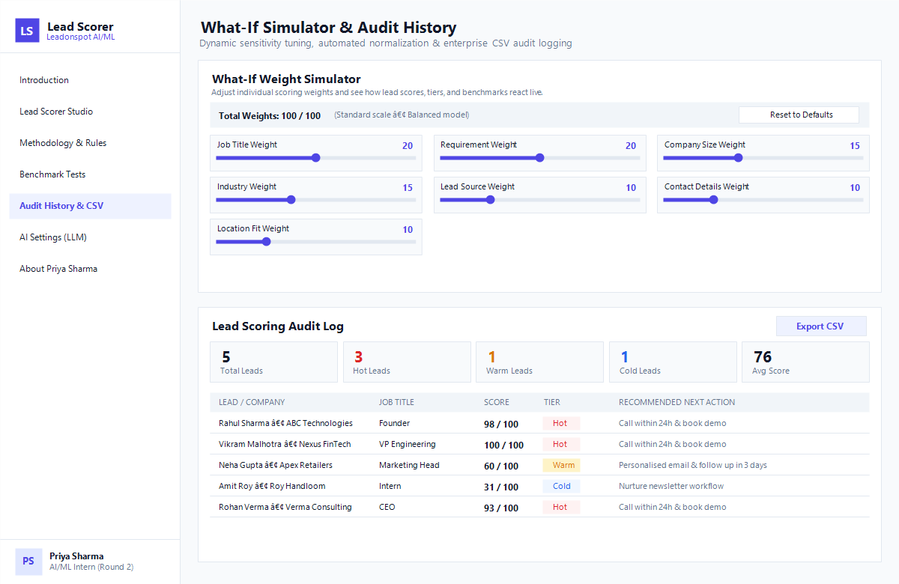

# AI-Based Lead Scoring System

> **Internship Assignment Project**  
> Candidate: **Priya Sharma**  
> Role Applied: **AI/ML Intern (Round 2), Leadonspot**  
> Live Demo: [https://leadonspot-lead-scorer.vercel.app](https://leadonspot-lead-scorer.vercel.app) *(Replace with your deployed Vercel URL)*

---

## 1. Overview

Hi, I am Priya Sharma. This is my submission for Round 2 of the AI/ML Internship at Leadonspot.

When sales teams receive dozens of leads every day, prioritizing who to reach out to first is critical. Many traditional ML models act as black boxes: sales reps are handed a probability number, but cannot tell why one lead is ranked higher than another, or what to say on the phone. Furthermore, stochastic generative AI can hallucinate scores or produce different results for identical inputs.

I built this **AI-Based Lead Scoring System** to solve this problem. It is a lightweight, zero-dependency, self-contained single-file web application (`index.html`). It scores B2B sales leads on a 0–100 scale using a transparent, 100% deterministic, explainable weighted rule engine. Identical inputs will always produce identical scores.

An optional AI layer can rewrite the deterministic score breakdown into an executive briefing for sales reps, but the scoring algorithm itself is strictly deterministic.

---

## 2. Key Features

- **100% Explainable & Deterministic:** Every point earned or deducted is tied to explicit commercial intent, ICP fit, and contact reachability criteria.
- **Dynamic Circular Gauge & Tier Badges:** Smoothly animates score count-up (0 to 100) and badges leads as **Hot** (≥70), **Warm** (40–69), or **Cold** (<40).
- **Instant Factor Attribution:** Highlights positive drivers (green) and deductions or missing fields (red) with individual point contributions.
- **Data Confidence Meter:** Measures data completeness based on the percentage of lead fields filled (>90% High, 60–90% Medium, <60% Low).
- **Actionable Next Steps:** Automatically assigns standard operating procedures for sales reps (e.g., Hot: *Call within 24 hours & book demo*; Warm: *Personalised email & follow up in 3 days*; Cold: *Nurture newsletter*).
- **Interactive "What-If" Weight Simulator:** Collapsible simulator allows sales managers to tweak sliders (0–40) for all 7 scoring criteria, with live normalization and benchmark impact analysis.
- **Audit History & CSV Export:** Automatically records scored leads in local browser storage (`localStorage`) with a summary metric strip and one-click CSV export.
- **Optional AI Enhancement:** Sales reps can optionally enter a Google Gemini or OpenAI API key directly in Settings. The LLM only rewrites the explanation into an executive briefing—the score and tier remain 100% deterministic.
- **Pure Client-Side Architecture:** Built entirely in Vanilla HTML5, CSS3, and plain JavaScript. Zero external CDNs, fonts, or server-side dependencies. Works completely offline.

---

## 3. Scoring Methodology & Weights

The default scoring algorithm sums to 100 total points across 7 weighted attributes:

| Category | Max Points | Evaluation Logic & Criteria |
| :--- | :---: | :--- |
| **Job Title** | **20** | • **20 pts:** C-Level / Decision Maker (`Founder`, `CEO`, `Owner`, `Director`, `VP`)<br>• **12 pts:** Management (`Manager`, `Head`, `Lead`)<br>• **5 pts:** Individual Contributor / Other<br>• **0 pts:** Empty |
| **Requirement** | **20** | • **20 pts:** Commercial intent keywords (`CRM`, `software`, `ERP`, `automation`, `solution`, `demo`, `pricing`)<br>• **8 pts:** Other requirement text provided<br>• **0 pts:** Empty |
| **Company Size** | **15** | • **15 pts:** `50-100` or `100-500` employees (Sweet-spot mid-market)<br>• **12 pts:** `500+` employees (Enterprise)<br>• **10 pts:** `10-50` employees (Small business)<br>• **5 pts:** `1-10` employees (Micro team)<br>• **0 pts:** Empty |
| **Industry** | **15** | • **15 pts:** Primary ICP (`IT Services`, `SaaS`, `Finance`, `E-commerce`)<br>• **7 pts:** Other specified industry<br>• **0 pts:** Empty |
| **Lead Source** | **10** | • **10 pts:** High intent inbound (`Website`, `Referral`)<br>• **7 pts:** Warm channel (`LinkedIn`, `Event`)<br>• **3 pts:** Outbound cold channel (`Cold List`, `Other`)<br>• **0 pts:** Empty |
| **Contact Details** | **10** | • **Email (4 pts):** Corporate domain = 4 pts; Free/generic webmail (`gmail`, `yahoo`, `hotmail`, `example.com`) = 2 pts; Empty = 0 pts<br>• **Phone (3 pts):** Valid 10–13 digit phone = 3 pts; Empty = 0 pts<br>• **Website (3 pts):** Valid domain format = 3 pts; Empty = 0 pts |
| **Location** | **10** | • **10 pts:** Tier-1 Indian tech hubs (`Bangalore`, `Mumbai`, `Delhi`, `Hyderabad`, `Pune`, `Chennai`, `Gurgaon`, `Noida`)<br>• **6 pts:** Other specified cities<br>• **0 pts:** Empty |
| **Total** | **100** | **Normalized Scale (0 – 100)** |

### Classification Tiers:
- **Hot Lead (Score ≥ 70):** Red badge. Immediate priority. Outreach SLA: Call within 24h & book demo.
- **Warm Lead (Score 40 – 69):** Amber badge. Nurturable prospect. Outreach SLA: Personalised email & follow up in 3 days.
- **Cold Lead (Score < 40):** Blue badge. Low ICP fit or unverified contact info. Outreach SLA: Nurture newsletter.

---

## 4. Missing-Data Handling & Determinism

In real-world sales pipelines, inbound lead forms frequently have blank or incomplete fields. This system is designed so that it **never crashes**:

1. **Zero Point Default:** Any missing field is awarded 0 points.
2. **Transparent Negative Factors:** Missing attributes are explicitly surfaced in the *Deductions / Missing* list (e.g. `"Phone number missing (0 pts)"`, `"Job title missing (0 pts)"`).
3. **Contact Domain Penalty:** If a personal email address (like `gmail.com` or `example.com`) is provided instead of a corporate domain, a 2-point deduction is flagged.
4. **Data Confidence Rating:** The application computes the percentage of total fields completed:
   $$\text{Confidence Score} = \frac{\text{Filled Fields}}{11} \times 100$$
   - `> 90%`: High Confidence
   - `60% – 90%`: Medium Confidence
   - `< 60%`: Low Confidence

---

## 5. How the LLM is Used

A core design principle of this project is that **AI does not calculate or modify the score**:

- **Scores are 100% deterministic:** The numerical score (0–100), the tier (Hot/Warm/Cold), and the positive/negative breakdowns are calculated directly in JavaScript.
- **LLM role is strictly explanatory:** If a user configures a Google Gemini or OpenAI API key in the *AI Settings* tab, the app can call the model directly from the browser (`fetch`) to turn the raw points into a fluent executive sales briefing.
- **Prompt Guardrail:** The prompt sent to the LLM explicitly instructs: *"The lead has already been scored deterministically at X/100 (Tier). Do NOT change or recalculate the score."*
- **Security & Privacy:** API keys are never stored on a server or committed to Git. They are saved strictly in the user's browser `localStorage`. If no key is entered, the app uses a built-in deterministic explanation generator.

---

## 6. How to Run Locally

Because this project is built entirely in vanilla HTML, CSS, and JavaScript with zero external build tools:

1. Clone or download this repository.
2. Double-click `index.html` to open it directly in any modern web browser (Google Chrome, Microsoft Edge, Mozilla Firefox, Safari).
3. Alternatively, you can use any static local file previewer:
   ```bash
   # Optional: if you have an HTTP server installed
   npx serve .
   ```
4. Click **Load Sample Lead** to test the default lead profile (Rahul Sharma, ABC Technologies).

---

## 7. Benchmark Test Cases & Expected Scores

The **Test Cases** tab has 5 pre-configured leads that can be scored with a single click:

| Test Case | Lead Name & Company | Role & Context | Expected Score | Expected Tier | Confidence |
| :--- | :--- | :--- | :---: | :---: | :---: |
| **Default Sample** | Rahul Sharma (ABC Technologies) | Founder, Bangalore, CRM software intent, generic email domain | **98** | Hot | High (100%) |
| **Benchmark 1** | Vikram Malhotra (Nexus FinTech Labs) | VP of Engineering, Mumbai, Finance, urgent ERP/CRM intent | **100** | Hot | High (100%) |
| **Benchmark 2** | Neha Gupta (Apex Retailers) | Marketing Head, Jaipur, Retail, generic requirement | **60** | Warm | High (100%) |
| **Benchmark 3** | Amit Roy (Roy Handloom Workshop) | Intern, micro team, cold list, missing phone and website | **31** | Cold | Medium (64%) |
| **Benchmark 4** | Sneha Patel (QuickTech) | Operations, multiple missing fields (no phone, location, size) | **27** | Cold | Low (36%) |
| **Benchmark 5** | Rohan Verma (Verma Consulting) | CEO, SaaS, Delhi, strong intent but personal `@gmail.com` | **93** | Hot | High (100%) |

---

## 8. What-If Weight Simulator

Sales strategies change depending on target markets. A team selling enterprise software might care deeply about company size, while a self-serve PLG startup cares primarily about inbound website intent.

The built-in **What-If Weight Simulator**:
- Provides individual sliders (0 to 40) for each of the 7 criteria.
- Shows total weight. When the sum is not equal to 100, scores are automatically normalized:
  $$\text{Normalized Score} = \text{round}\left(\frac{\text{Earned Points}}{\sum \text{Max Weights}} \times 100\right)$$
- Instantly recalculates the currently active lead, all items in the history log, and the benchmark test table.
- Highlights classification transitions (e.g. `Warm ➔ Hot`).
- Includes a one-click **Reset to Default Weights** button.

---

## 9. Deploying on Vercel

The repository is configured for zero-configuration deployment on Vercel using `vercel.json`:

### Option A: Via Vercel Web Dashboard (Recommended)
1. Push this repository to GitHub.
2. Go to [vercel.com](https://vercel.com) and log in.
3. Click **Add New Project** and select your GitHub repository.
4. Framework Preset: **Other** (Root directory: `./`).
5. Build Command: Leave blank (no build step needed).
6. Output Directory: Leave blank.
7. Click **Deploy**. Vercel will immediately deploy `index.html`.

### Option B: Via Vercel CLI
```bash
# 1. Install Vercel CLI globally
npm i -g vercel

# 2. Deploy preview
vercel --yes

# 3. Deploy to production
vercel --prod
```

---

## 10. Screenshots

*(Placeholders for presentation screenshots)*

| Main Scorer Dashboard | What-If Simulator & History |
| :---: | :---: |
|  |  |

---

## 11. Code & Navigation Structure

All code is cleanly structured into single-responsibility sections in `index.html`:

```
index.html
├── <head>
│   └── <style>              # Modern SaaS CSS: Desktop sidebar layout, responsive mobile grid, SVG gauge
├── <body>
│   ├── <aside class="sidebar">  # Left Navigation Sidebar:
│   │   ├── Brand Logo & Leadonspot Badge
│   │   ├── 🏠 Introduction (Default landing page)
│   │   ├── 🎯 Lead Scorer Studio (Interactive Form + Circular Gauge)
│   │   ├── ⚖️ Scoring Methodology (Transparent 100-pt matrix)
│   │   ├── 🧪 Benchmark Tests (5 one-click validation cases)
│   │   ├── 📜 Audit History & CSV Export
│   │   ├── ⚙️ AI Settings (Optional Gemini / OpenAI key)
│   │   ├── 👩‍💻 About the Author (Priya Sharma Profile)
│   │   └── Candidate Footer Pill
│   │
│   └── <main class="main-wrapper">
│       ├── #tab-intro       # Overview, problem vs solution, architecture workflow
│       ├── #tab-scorer      # Two-column Lead Scorer + What-If Simulator
│       ├── #tab-methodology # Complete criteria breakdown table
│       ├── #tab-test-cases  # Benchmark archetypes with one-click scoring
│       ├── #tab-history     # LocalStorage audit log + metric strip + CSV download
│       ├── #tab-settings    # Client-side API key configuration
│       └── #tab-author      # Priya Sharma Candidate Statement & technical skills
│
└── <script>
    ├── 1. Weights           # SCORING_WEIGHTS & DEFAULT_WEIGHTS
    ├── 2. Validation        # isValidEmail, isValidPhone, isValidWebsite, validateForm
    ├── 3. Category Scoring  # getJobTitlePoints, getRequirementPoints, getCompanySizePoints... (<20 lines each)
    ├── 4. Main Score Lead   # scoreLead(lead) -> { score, breakdown, positives, negatives, ... }
    ├── 5. Explanation       # generateExplanation (deterministic template)
    ├── 6. UI Controllers    # showResults, animateScoreGauge, renderBreakdownTable
    ├── 7. What-If Simulator # handleWeightSliderChange, resetWeightsToDefault
    ├── 8. LocalStorage      # saveHistoryEntry, renderHistoryTable, exportHistoryToCsv
    └── 9. Tab Routing       # switchTab, DOMContentLoaded lifecycle
```

---

*Submitted with pride by **Priya Sharma** for Leadonspot AI/ML Internship Evaluation.*
